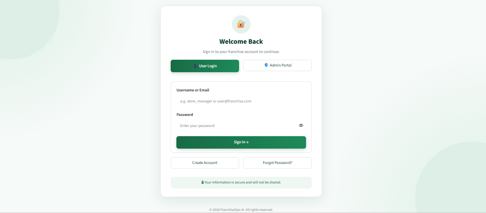
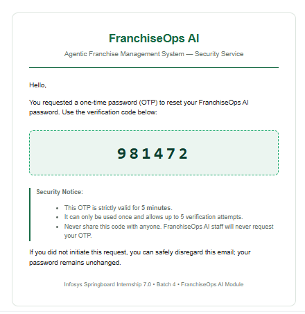
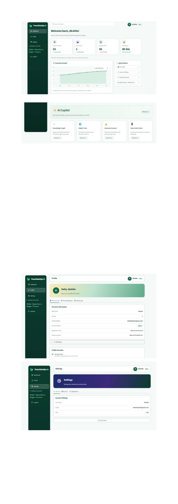
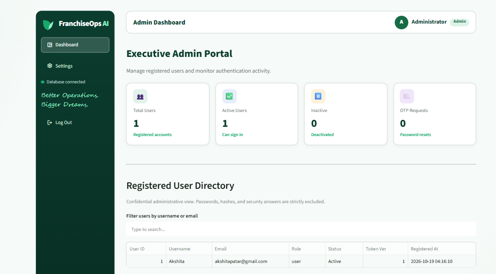

# Milestone 1 - User Authentication Module

## Milestone 1
Here we will build the login and account system for the
project.

## Features Built
- Signup with username, email, password, security question and answer
- Login with JWT session tokens
- Forgot Password using a security question or an email OTP
- Field validation (mandatory fields, email format, password strength)
- User Dashboard with logout
- Admin Dashboard listing registered users

## Tech Stack
- Python, Streamlit (UI)
- JWT / PyJWT (sessions)
- bcrypt (password hashing)
- SQLite (user storage)
- ngrok (public URL)
- Gmail SMTP with an App Password (OTP emails)
- Google Colab (running the notebook)

## How to Run the Notebook
1. Open the notebook in Google Colab.
2. Add these secrets in the key-icon panel and enable notebook access:
   JWT_SECRET, NGROK_AUTHTOKEN, EMAIL_ADDRESS, EMAIL_PASSWORD
   (plus ADMIN_USER and ADMIN_PASS if you read the admin login from secrets).
3. Run all cells from top to bottom.
4. Open the ngrok URL printed by the last cell.

## Screenshots
### Login

### Signup

### Forgot Password (Security Question)

### Forgot Password (OTP)

### OTP Email

### User Dashboard

### Admin Dashboard

