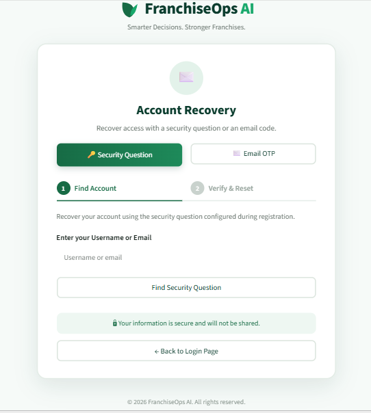
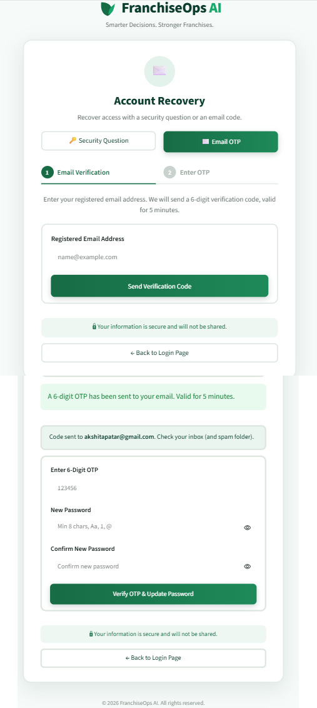

<p align="center">
  
</p>

<h1 align="center">🌿 FranchiseOps AI — Milestone 1</h1>
<h3 align="center">User Authentication Module</h3>
<h4 align="center">Streamlit · JWT · Gmail OTP · SQLite · ngrok</h4>

<p align="center">
  <strong>Infosys Springboard Internship 7.0 &bull; Batch 4</strong><br/>
  <em>"Smarter Decisions. Stronger Franchises."</em>
</p>

<p align="center">
  
  
  
  
  
</p>

---

## 👋 Hey there! Let me walk you through what I built.

This is **Milestone 1** of my Infosys Springboard Internship project — **FranchiseOps AI**, which stands for *Agentic AI for Franchise Management System with Performance Monitoring Assistance*.

Before any AI agent can give franchise insights, recommend stock levels, or flag underperforming outlets, the very first thing you need is a rock-solid **authentication system**. Who is the user? Are they who they say they are? Can they be trusted with this data?

That's exactly what I built here — a **complete, production-grade authentication module** that runs entirely inside a Google Colab notebook. No local server setup. No complex deployment. Just open the notebook, run all cells, and you get a **live public URL** with a full-featured SaaS web application.

---

## 🎯 What Exactly Did I Build?

Here's a plain-English breakdown of every feature in this milestone:

### 🔐 1. Secure User Registration
When a new user signs up, the system:
- Validates their **username** (3–30 alphanumeric characters, no spaces)
- Validates their **email** (proper format with a real domain)
- Checks **password strength** — must have uppercase, lowercase, a digit, and a special character
- Detects and **blocks duplicate** usernames or emails with clear error messages
- Hashes the password using **bcrypt** (12 rounds) — so even if someone steals the database, they can't reverse the passwords
- Lets the user pick a **security question** (e.g. "What was your first pet's name?") and stores the answer as a hash — never in plain text

### 🔑 2. Flexible Login with JWT Sessions
Users can log in with either their **username or email** — whichever they prefer. On success:
- The system creates a signed **JWT token (HS256)** that acts like a digital ID card
- Tokens are valid for **1 hour** by default, or **7 days** if "Remember Me" is checked
- Failed login attempts show a **generic error** — so attackers can't figure out if a username exists or not

### ♻️ 3. Instant Session Invalidation (Server-Side Revocation)
Here's something that even many real-world apps get wrong. Normally, if you reset your password, old sessions (JWTs) stay valid until they expire naturally. I fixed this:
- Every user has a `token_version` number stored in the database
- When a password is reset, **that number increments**
- Any existing JWT with the old version is **immediately rejected** on the next request — even if it technically hasn't expired yet

### 🔒 4. Two-Route Password Recovery
I built **two completely different password recovery methods**:

**Route A — Security Question:**
- The user enters their username or email
- The system shows their chosen security question
- They have **5 attempts** before recovery temporarily locks
- Correct answer → they set a new password

**Route B — Gmail OTP:**
- The user requests a 6-digit OTP sent to their registered email
- A **beautifully styled HTML email** is delivered via Gmail SMTP with TLS encryption
- The OTP is valid for **5 minutes**, has a **60-second cooldown** between resend attempts, allows a max of **5 verification tries**, and is single-use (consumed immediately on success)
- Correct OTP → they set a new password

### 📊 5. User Profile & SaaS Dashboard
After logging in, users land on a clean dark-themed SaaS dashboard:
- Personalized greeting: **"Welcome back, Akshita!"**
- Their **account details**: User ID, email, account status badge, registration timestamp, session expiry time
- An **AI Copilot panel** and preview cards for upcoming FranchiseOps AI modules (Outlet Performance, Inventory Intelligence, Workforce Scheduling — planned for Milestone 2+)

### 🛡️ 6. Executive Admin Portal
A completely separate admin login route:
- Protected by **server-side role verification** — not just client-side checks
- Admins see **live metrics**: Total Users, Active Users, Inactive Users, OTP requests
- A **searchable user directory** — names and emails only; passwords, hashes, and security answers are **strictly hidden**

---

## 🛠️ Tech Stack — And Why I Chose Each One

| Tool | What It Does Here | Why This One? |
|:-----|:-----------------|:--------------|
| **Python 3** | Core language for all logic | Universal for both data science and web apps |
| **Streamlit** | Builds the entire web UI + manages page state | Python-native, no HTML/CSS/JS needed for rapid prototyping |
| **Google Colab** | Runs everything in the cloud | Anyone can open and run without installing anything locally |
| **SQLite** | Stores users, OTPs, session data | Zero-config, file-based — perfect for Colab demonstrations |
| **bcrypt** | Hashes all passwords | Intentionally slow — defeats brute-force attacks by design |
| **PyJWT** | Creates & verifies session tokens | Industry-standard, tamper-proof, stateless sessions |
| **secrets + hashlib** | Generates OTPs, hashes answers & OTPs | Cryptographically secure — not the standard `random` module |
| **smtplib** | Sends OTP emails via Gmail | Built into Python, works seamlessly with Gmail App Passwords |
| **pyngrok** | Creates a public HTTPS URL from Colab | Exposes localhost:8501 without needing any server or domain |
| **Colab Secrets** | Stores sensitive keys safely | Keeps tokens out of code — no accidental GitHub leaks |

---

## 🔑 Setting Up Google Colab Secrets (Do This First!)

The app needs 4 secret values to function. **Never paste these directly into code cells** — use Colab's built-in Secrets manager instead:

1. Open the notebook in [Google Colab](https://colab.research.google.com)
2. Click the **🔑 Key icon** in the left sidebar
3. Click **+ Add new secret** and add all 4 entries below:

| Secret Name | What to Enter |
|:------------|:-------------|
| `JWT_SECRET` | Any long random string (e.g. `franchiseops-jwt-secret-key-2026`) |
| `NGROK_AUTHTOKEN` | Your token from [dashboard.ngrok.com](https://dashboard.ngrok.com/get-started/your-authtoken) |
| `EMAIL_ADDRESS` | The Gmail address that will send OTP emails |
| `EMAIL_PASSWORD` | Your 16-character **Gmail App Password** (see instructions below) |

> ⚠️ **Important:** For each secret, make sure the **"Notebook access"** toggle is turned **ON** — otherwise the notebook can't read the value.

### How to Get a Gmail App Password (Step by Step)

1. Go to [myaccount.google.com/security](https://myaccount.google.com/security)
2. Make sure **2-Step Verification** is **ON** (this is required by Google)
3. In the search bar at the top, type **"App passwords"** and open it
4. Give it a name like `FranchiseOps AI` and click **Create**
5. Google shows a 16-character code — like `abcd efgh ijkl mnop`
6. Copy it **without spaces** and paste into Colab Secrets as `EMAIL_PASSWORD`

---

## 🚀 How to Run the Notebook

1. **Open the Notebook** — Upload `FranchiseOps_AI_Milestone1.ipynb` to [Google Colab](https://colab.research.google.com)
2. **Configure Secrets** — Add all 4 Colab Secrets with "Notebook access" toggled ON
3. **Run All Cells** — Click **Runtime → Run all** in the top menu (or press `Ctrl + F9`)
4. **Wait ~60 Seconds** — The notebook installs dependencies, initializes the database, writes the app, and launches Streamlit in the background
5. **Find Your Public URL** — Scroll to the output of the last cell. You'll see:

```
=================================================================
  FRANCHISEOPS AI IS LIVE!
  Public URL: https://xxxx-xx-xx-xx-xx.ngrok-free.app
=================================================================
```

6. **Click the Link** — If ngrok shows a warning page, just click the blue **"Visit Site"** button to enter the application

---

## 🧪 Testing the App — A Complete Walkthrough

### ✅ Step 1 — Register a New Account
- On the login card, click **Create Account**
- Try entering a weak password like `test123` — you'll see an immediate validation error explaining what's missing
- Enter a valid one like `Franchise@2026`
- Fill in a username, a real email address, pick a security question, and type your answer
- Click **Register** — you'll see a green success banner

### ✅ Step 2 — Log In & Explore the Dashboard
- Sign in with your new credentials (you can use your username **or** email — both work)
- On the **Dashboard** tab: see your metrics, Franchise Growth chart, Quick Actions panel, and upcoming AI Copilot modules
- On the **Profile** tab: your personal info, account status badge (Active/Inactive), session expiry timer
- On the **Settings** tab: account details and appearance options
- Click **Log Out** in the sidebar to end the session

### ✅ Step 3 — Test Forgot Password via Security Question
- Click **Forgot Password?** on the login screen → choose **Method 1: Security Question**
- Enter your username/email → click **Find My Question**
- Type your answer (the system normalizes spacing and capitalization, so don't worry about exact case)
- Enter a new strong password → click **Reset Password**
- Try logging in with your **old** password — it gets rejected immediately
- Log in with your **new** password — it works, and all old sessions are revoked

### ✅ Step 4 — Test Forgot Password via Email OTP
- On the Forgot Password screen, choose **Method 2: Email OTP**
- Enter your registered Gmail → click **Send 6-Digit OTP**
- Open Gmail — you'll find a branded FranchiseOps AI email with a large OTP code
- Enter that 6-digit code + a new password → click **Verify & Reset**
- Log in with the new password to confirm it worked ✓

### ✅ Step 5 — Test the Admin Portal
- On the main login screen, switch to the **Admin Portal** tab
- Username: `admin` | Password: `Admin@FranchiseOps2026`
- Click **Authenticate as Admin**
- View the live metrics dashboard and the searchable user directory table
- Notice: no passwords, hashes, or security answers are visible anywhere in the admin view

---

## 📁 Repository Structure

```
Milestone1/
├── FranchiseOps_AI_Milestone1.ipynb   ← Self-contained Colab notebook (all code inside)
├── README.md                          ← This file — full documentation & guide
└── screenshots/                       ← Application screenshots
    ├── logo.png                       ← FranchiseOps AI brand logo
    ├── login.png                      ← Login page & Admin Portal tab
    ├── signup.png                     ← Account registration form
    ├── forgot_password_security_question.png  ← Security question recovery
    ├── forgot_password_otp.png        ← OTP entry & password reset form
    ├── otp_email.png                  ← Delivered OTP email in Gmail inbox
    ├── user_dashboard.png             ← User profile, dashboard & settings (all pages)
    └── admin_dashboard.png            ← Admin portal & user directory
```

---

## 📸 Application Screenshots

### 1. User Login & Admin Portal Tab


---

### 2. Account Registration


---

### 3. Password Recovery — Security Question


---

### 4. Password Recovery — Email OTP


---

### 5. OTP Email Delivered in Gmail Inbox


---

### 6. User Profile & SaaS Dashboard


---

### 7. Executive Admin Portal & User Directory


---

## ⚠️ Limitations & Things to Know

- **Colab storage resets on disconnect** — The SQLite database (`users.db`) and all generated files live in Colab's `/content/` directory. They are wiped when the runtime disconnects or Google recycles the virtual machine. This is expected behavior for a Colab demo — in production, you'd use a persistent hosted database.
- **ngrok URLs change every session** — Every time you start a new tunnel, you get a fresh public URL. Just scroll to the last cell output to find the new one.
- **Free ngrok has limits** — The free tier supports 1 active agent and limited monthly bandwidth. For a class demo or grading, this is more than sufficient.
- **No sensitive data is ever logged** — Passwords, security answers, OTP codes, hashes, and JWT secrets are never printed to notebook outputs or stored unencrypted anywhere in the system.

---

## 🏁 Submission Checklist

- [x] `Milestone1/` sub-repository created inside the main project repo
- [x] `FranchiseOps_AI_Milestone1.ipynb` — fully self-contained Google Colab notebook
- [x] `README.md` — detailed, humanized documentation (this file)
- [x] User Registration with bcrypt hashing (12 rounds) + security question hashing
- [x] Login accepting username or email + JWT HS256 session tokens
- [x] Server-side token revocation via `token_version` on password reset
- [x] Forgot Password via Security Question (5 attempt limit)
- [x] Forgot Password via Gmail SMTP OTP (5 min expiry, single-use, cooldown)
- [x] User Profile & SaaS Dashboard with upcoming module previews
- [x] Executive Admin Portal with RBAC + searchable user directory
- [x] All secrets handled via Google Colab Secrets (zero hardcoded credentials)
- [x] All 7 screenshots captured, embedded, and linked in this README

---

<p align="center">
  Made with care for <strong>Infosys Springboard Internship 7.0 — Batch 4</strong><br/>
  <em>FranchiseOps AI &bull; Milestone 1 &bull; Authentication Module</em>
</p>

---

